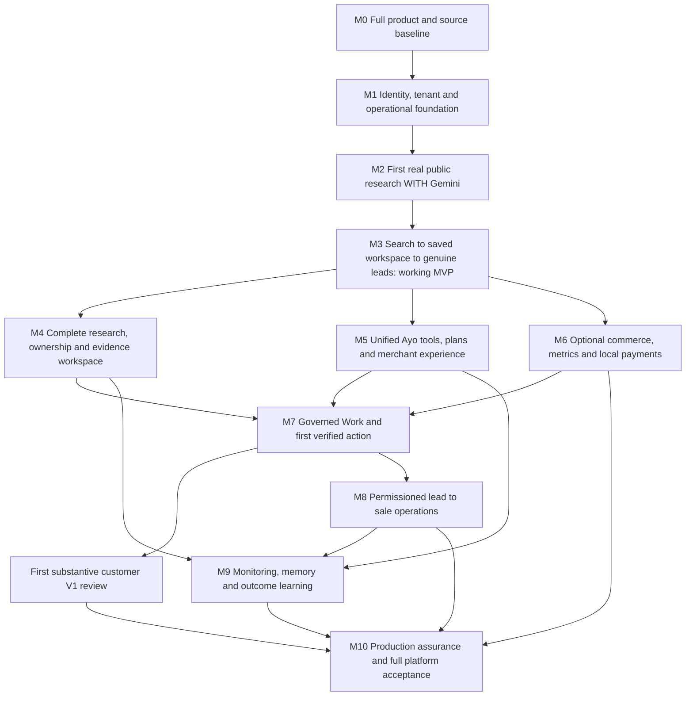

# Ayo — roadmap to the complete platform

Version: 2026-10-25. Overall status: **PARTIALLY COMPLETE; required live acceptance BLOCKED**. Product scope is [PRODUCT_VISION.md](PRODUCT_VISION.md). This roadmap replaces narrow MVP-only sequencing as the delivery destination; [PLAN.md](PLAN.md) remains an earlier execution checkpoint. Working code is preserved. No application feature development is part of this vision-documentation checkpoint.

## 1. Delivery rules and status

Build in dependencies, retaining each useful vertical slice. A milestone needs implemented behavior, meaningful tests, persisted evidence and its stated live/reviewer checks. Milestone names do not imply completion. Do not mark a whole milestone blocked solely by credentials when independent implementation remains possible; separate those work items.

| Label | Meaning |
| --- | --- |
| VERIFIED LOCAL | Code executed with stated local/CI tests; specify PostgreSQL and offline fixtures. Not a live-provider claim. |
| VERIFIED LIVE | The stated provider/source/user path worked in an authorized environment with retained redacted receipts. Does not automatically mean production-ready. |
| PARTIAL | Some implementation or acceptance exists; list the remaining functionality and proof. |
| PLANNED | Required behavior has not been implemented. A design/schema or candidate integration is not a working feature. |
| BLOCKED LIVE | Specific missing credential, policy, permission, environment or independent review prevents the named external check. Other implementation can continue. |

Changes must record scope, capability IDs, migration/API effects, permissions, evidence, error/rollback behavior, tests and remaining risk in PROGRESS and FEATURE_STATUS, then commit verified changes to the designated GitHub review branch. Public deployment, paid calls, merchant changes and outreach require the existing task-specific approval or new explicit authorization for the actual operation. The prior protected preview authorization does not authorize a production merchant release or provider spending.

## 2. Starting point and source review

The original ZIP, extracted working source and test history are retained. This checkpoint re-extracted **49 original specification documents/manifests** separately and reviewed docs 00–28, both 25 documents, founder/agent/build instructions and eight architecture JSON contracts. [Source inventory/hash receipt](docs/evidence/product-vision-source-audit.json). Historical Emergent source remains unavailable; no blind replacement/consolidation is assumed.

Last recorded verified application baseline: **222 tests passed with local PostgreSQL, zero skipped**, one upstream warning; responsive offline workflow evidence at 390/768/1440px, local container/dependency/security checks and GitHub review delivery. This documentation-only checkpoint does not claim a newly run application suite. See [PROGRESS](PROGRESS.md), [offline browser receipt](docs/evidence/offline-browser-workflow.json), [restricted preview receipt](docs/evidence/protected-preview.json).

Current services include identity/membership/session lifecycle, founding allocation, migrations, encrypted research jobs/mail outbox, bounded source/report contracts, claim isolation, deterministic single-page reports, lead discovery/qualification contracts, merchant screens and separate Gemini/Claude analysis adapters. They are predominantly **VERIFIED LOCAL WITH FIXTURES**. The protected preview serves intake and labeled screenshot evidence only; accounts and external providers remain disabled.

**Important gap:** the public report worker currently calls deterministic `ResearchService.research`; the model gateway is used separately for saved-workspace analysis. The existence of a Gemini adapter does not satisfy the first Gemini-assisted research milestone. Wiring and validating Gemini into the early report path is unfinished implementation as well as blocked live testing.

## 3. Dependency map and milestone boundaries

M0–M1 foundations may be tightened alongside later slices. Founding entitlements belong in signup foundations, not at a final marketing launch. **M2 includes Gemini immediately**; M5 expands orchestration rather than introducing the first AI call. M3 is a working MVP milestone. M7/V1 is a later customer-release milestone. Only M10 can establish completion of the committed full platform; passing M3 or V1 cannot substitute for it.

## 4. Milestones, remaining implementation and acceptance

### M0 — Permanent full-product and source baseline

**Covers:** all capability IDs for scope. **Status:** documentation/source audit implemented at this checkpoint; no new application functionality claimed.

- Preserve ZIP/source hashes; reconcile conflicting historical requirements; publish PRODUCT_VISION and this roadmap; expand current status beyond onboarding.
- Preserve the distinction between required capabilities, proposed provider choices and uncommitted expansion. Map every required capability to implementation and live acceptance.
- Make Gemini's early participation, one Ayo, optional Shopify and user-based founding entitlements permanent constraints. Link active delivery documents from README.

**Exit:** file/link/coverage checks pass; original architecture source remains intact; docs are committed to the correct repository and independently reviewable. Historical source unavailable is documented, not presumed merged. Revisit source ADR if supplied later.

### M1 — Identity, tenancy, entitlements and reliable foundations

**Covers:** C01, C03, C15–C18. **Depends on:** M0. **Status:** PARTIAL; substantial local verification.

**Already implemented:** explicit PostgreSQL migrations; normalized password accounts, hashed/revocable sessions, verification/reset tokens, persistent throttles, encrypted mail outbox, business memberships and switching, local removal/retention, atomic founding-user slots and concurrency tests, research job leases, validation/security headers, CI/dependency/secret checks.

**Remaining implementation:** complete team invitation/membership administration and privileged-account controls; legitimate-account abuse/eligibility/review policy; durable per-tenant/resource cost ledger; stronger correlated operational logging/audit and admin/recovery procedures; production retention/export/privacy workflows. Harden job cancellation/backoff/dead-letter and operational visibility as later job types arrive. Assess MFA/step-up for privileged actions and record the adopted control.

**External dependencies:** production/staging PostgreSQL and persistent worker hosting; durable separate signing/encryption secrets; verified transactional sender and authorized mail credentials; reviewed privacy/eligibility policy. No permission to provision paid resources is implied.

**Exit evidence:** PostgreSQL migration preservation/rollback and multi-worker tests; hostile two-tenant role/session/job/export cases; delivered verification/reset emails and replay/revocation checks; 499/500/501 concurrent grants, duplicate/abuse handling and future-feature entitlements across workspaces; backup/restore and credential-rotation procedure before production. Production readiness remains pending even if local foundation tests pass.

### M2 — FIRST functional business research, including Gemini

**Covers:** C02–C04, C06, C16–C18. **Depends on:** M1 boundaries, safe acquisition and approved provider setup. **Status:** PARTIAL IMPLEMENTATION + BLOCKED LIVE.

**Already implemented:** name/link/market/city intake, candidate-selection interface, no-website labeled descriptions; fixed-host Firecrawl search/fetch adapter, explicit source/spend gates, bounded public extraction and dated hashed evidence; leased research jobs; deterministic observed/inferred/unknown report; separate structured Gemini/Claude gateway with citation checks.

**Remaining implementation, before calling this milestone functional:**

1. Wire **Gemini** into the initial public research worker/report pipeline after actual evidence retrieval/storage. Use a bounded public-evidence context, not an invented private tenant or model-controlled URL. Persist provider/model/version, usage, timestamps and validated source links with the report.
2. Validate structured observations, inference, uncertainty and recommendations against acquired sources. Reject unsupported citations/financial claims/action claims. A missing/invalid/unavailable model produces a truthful partial/unavailable state; never silently label a rules-only report Gemini-assisted.
3. Enforce independent acquisition/inference budgets, failure/retry boundaries, input limits, safe provider-data disclosure and job progress. Choose reviewed model IDs. Retain compatible model interfaces for optional Claude without routing private data silently.
4. Complete policy acceptance for permitted sources and controlled provider egress/redirect/robots handling. Configuration flags are operator attestations, not evidence that the vendor prevents SSRF or honors access policies.
5. Verify disambiguation with real Nigerian/Ghanaian businesses, public social/marketplace failures and no-online-presence fallback. No fabricated domain/contact or ownership assumption.

**Live blockers:** `FIRECRAWL_API_KEY` or an approved replacement source adapter; `GEMINI_API_KEY` and available `GEMINI_MODEL`; approved source/egress/terms and provider data policy; explicit spend authorization and limit. Configure secrets through secure runtime settings, never chat/Git. Google Search grounding/URL Context can be evaluated separately; neither bypasses Ayo acquisition policy.

**Exit evidence:** at least one real business in Nigeria and one in Ghana researched under permitted access; a **real authorized Gemini API call in this first research milestone**, source snapshots and model receipt tied to the same report; independent source-to-claim check; unsupported output/injection, source denial, absent model, throttling and budget-exhaustion tests. Pre-signup report must already be useful and truthful. This exit is BLOCKED until actual credentials/authorization exist.

### M3 — Complete search → report → account → leads journey: working MVP

**Covers:** C01–C09 in an initial read/research slice, C12, C15, C18. **Depends on:** M2 and actual mail delivery from M1. **Status:** HTTP/browser journey VERIFIED LOCAL WITH FIXTURES; real journey BLOCKED LIVE.

**Already implemented:** anonymous report TTL/capabilities, one-use verified-account claim, persistence/private report/dashboard reopen, genuine-provider candidate contracts, domain/profile-aware lead deduplication, cited fit and merchant qualification, tenant access tests. Founding grants do not count extra workspaces.

**Remaining:** integrate Gemini-assisted report persistence/rendering from M2; complete owner-provided profile persistence/corrections and no-site onboarding; validate optional organization-only lead preview before signup; improve business/offer/audience capture and research-source quality. Qualification must stay distinct from contact eligibility and sales.

**Exit evidence:** a new user independently searches/selects a real public business, receives a cited Gemini-assisted report **before login**, registers/verifies through delivered mail, saves the exact report, logs out/in and reopens it, then discovers real relevant organizations with inspectable sources. Repeat NG/GH cases and wrong-user/replay/expiry/ambiguous/no-results/blocked-social/no-site cases; Shopify can be skipped throughout. Include no fake leads/messages/metrics and all-feature founding access. Retain redacted IDs/receipts and a reviewer walkthrough.

**Boundary:** this is the first working MVP, not Ayo's finished product or full operating release.

### M4 — Full research, identity proof and evidence workspace

**Covers:** C02–C05, C08, C12, C14, C16, C18. **Depends on:** M3. **Status:** largely PLANNED beyond the current single-page slice.

**Build:** bounded quick/deep multi-page research; actual product/category/policy/customer-journey/discoverability findings; sourced positioning and up to three initial public competitor comparisons; source versioning/change history, freshness, contradictory evidence, correction/refetch and permitted export. Implement separate domain/site-control challenge verification and deliberate authorized public/private linkage. Persist owner-provided business knowledge with classification. Index/retrieve only access-permitted evidence; any vector store inherits tenant, purpose and deletion boundaries.

**Exit evidence:** multi-source report claims trace to actually fetched permitted pages; robots/terms/redirect/byte/deadline adversarial checks; unsupported competitor claims absent; corrupted/stale/conflicting evidence handled; false domain claim denied; report saving alone grants no site control; redacted licensed export/deletion tests and independent source review. Rendering or extra formats remain disabled until isolated and justified.

### M5 — One unified Ayo, grounded tools and complete merchant experience

**Covers:** C06–C08, C11, C14, C18. **Depends on:** M3, with M4/M6 tools becoming available as verified. **Status:** PARTIAL adapter/screens; registry/planning/memory mostly PLANNED.

**Build:** versioned permission-aware skill registry, deterministic query/metric tools, intent routing and bounded multi-step plans; evidence retrieval and tools for business/website/catalog/orders/inventory/lead fit; source-linked prioritized opportunities; persisted merchant goals/preferences and correctable contextual conversation. Complete Home/Ayo/Work/Grow/Business navigation and Help with actual capability states. Add Claude only through evaluated optional routing and disclosed data handling. Complete usage/cost telemetry and per-tenant limits rather than relying solely on token caps.

Keep the API/BFF and domain commands/queries typed and versioned as they expand; specify pagination, stable errors, queued-command/status semantics and idempotency. The original specimen `/api/v1` routes are design examples, not deployed endpoint evidence or a reason to break working routes without a migration.

**Exit evidence:** NG/GH benchmark of at least 20 diverse cases with independent fact review and predeclared thresholds; unsupported-claim/citation accuracy, tool choice, no-data/stale/currency conflict, latency/cost and injection tests; cross-tenant retrieval denial; no model-generated permission or phantom execution. Reconcile numbers through deterministic tool receipts. Context/memory deletion and source correction propagate. Keyboard/screen-reader and mobile/desktop checks cover actual tasks and error paths.

### M6 — Optional commerce, correct business metrics and regional payments

**Covers:** C10–C12, C16–C18. **Depends on:** M1/M3; does not gate public research. **Status:** Shopify alpha locally mock-tested; normalized sync and payment integrations PLANNED/BLOCKED LIVE.

**Build:** migrate the preserved user-keyed Shop/Snapshot alpha into business-scoped multi-connection entities without losing data; evaluate supported official Shopify auth/SDK contracts. Implement complete connection lifecycle, expiring token rotation/revocation, durable full/incremental sync, normalized catalog/variants/orders/inventory, checkpoints, API-cost/throttling/backoff, event deduplication and privacy request ledger. Remove arbitrary coverage caps or clearly preserve partial status. Implement versioned deterministic metrics and relevant inventory/catalog diagnosis.

Select and implement an authorized regional payment adapter based on actual NG/GH coverage (candidates Paystack/Flutterwave; Ghana Hubtel needs research). Reconcile signed payment events with orders, fees, refunds and settlement; separate pending transfers/MoMo from success and cash. Keep currencies separate unless an explicit dated FX source is supported. Evaluate later commerce/custom-site adapters without pretending every vendor is connected.

**Live dependencies:** Ayo-specific Shopify developer app/allowed HTTPS callbacks, consenting test store/scopes and protected-data/distribution review; payment sandbox credentials/permission and actual supported channels; hosting/secrets and explicit spending/merchant-action approval when needed. The separate ChatGPT Shopify connector grants none of these to Ayo.

**Exit evidence:** real OAuth/read/sync/uninstall/reinstall; empty and authorized nonempty stores, >750 records or documented coverage, partial failures/revoked scopes/duplicate events, two reporting periods independently reconciled to provider facts; NGN/GHS and timezone tests; signed payment webhook/replay/refund/settlement tests and actual approved sandbox receipts. No profit/ROAS/customer insight without supporting permitted cost/spend/PII data. Public-only merchants continue to work.

### M7 — Governed Work and the first real approved operation

**Covers:** C06, C07, C13, C16–C18. **Depends on:** M4/M5 and the relevant verified connector from M6. **Status:** PLANNED; no executable action engine exists.

**Build:** work-item/proposal persistence; before/after diff and exact affected resources; deterministic `BLOCKED / APPROVAL_REQUIRED / ALLOWED` policy; frozen content/target/actor/tenant/provider/scope/budget/expiry; immutable approval with invalidation on edits; role/current-scope/version/freshness rechecks; idempotent durable execution, conflict handling, uncertain-outcome reconciliation, verified receipts and reviewed rollback/compensation. Research and inference never possess execution credentials.

**First action:** product title/description improvement is the package's recommendation, not blanket permission to mutate Shopify. Confirm the narrow product choice and exact test merchant/provider scope before a real write. Keep every other mutation unavailable.

**Exit evidence:** unauthorized/cross-tenant/stale/expired/changed approval rejected; double-click/retry causes one authorized effect; interrupted/unknown results reconciled; approved real development-store operation verified by read-after-write and independent target/diff check; honest error and controlled undo with its own approval. Successful editing is not evidence of sales lift.

**First substantive customer V1 review:** M3 plus useful M5/M6 read capabilities, one real M7 operation, required security/privacy/operational pilot controls and actual founder-cohort access. This is still an intermediate release; M8–M10 remain.

### M8 — Full researched lead-to-sale workflow and compliant channels

**Covers:** C08, C09, C13, C16–C18. **Depends on:** M3 discovery, M4 evidence, M5 planning and M7 general action controls. **Status:** discovery/qualification PARTIAL; campaigns/drafts/sending/replies/deals PLANNED.

**Build:** business audience/campaign model, purpose and offer; evidence enrichment, fit factors/disqualifiers, dedupe review and freshness; shortlist/notes; editable source-bound pitch drafts. Implement recipient/channel/legal-basis/consent records, expiry, suppression/opt-out, verified sender and template rules, volume/cost limits, frozen approval and provider adapter. Store outreach attempts/message IDs, signed idempotent webhooks, delivery/reply reconciliation, meetings/opportunities/deals and loss/opt-out/duplicate/failure branches. Keep public business prospects separate from permitted existing-customer retention data.

Map the simple statuses **discovered → qualified → contacted → replied → converted** to explicit events; richer selected/drafted/approved/meeting/opportunity/won/lost states must not collapse them. A failed/uncertain send is not contacted; a reply is not a sale. Keep merchant-reported outcomes labeled and preserve evidence/attribution limitations.

**External gates:** source licensing; current Nigeria/Ghana privacy/direct-marketing assessment and vendor terms; lawful channel basis/opt-in as applicable (Ghana individual marketing and WhatsApp need their specific checks); approved sender/provider credentials; explicit test recipients and merchant send approval. No outreach or paid channel activity is authorized by this roadmap.

**Exit evidence:** genuine prospects independently source-checked; empty/duplicate/stale cases; unsupported pitch claims rejected; blocked consent/opt-out/edited approval even while queued; real authorized provider send/delivery/reply receipts with replay protection; controlled real or approved sandbox deal/payment reconciliation; merchant-reported result remains separate. Verify no unsolicited/private-account automation or invented contacts/sales.

### M9 — Persistent monitoring, business memory and outcome learning

**Covers:** C06, C11, C14, C16–C18. **Depends on:** M4/M5; M6/M8 supply relevant outcomes. **Status:** basic records/audit exist; end-state capability PLANNED.

**Build:** merchant-approved recurring refresh/sync/change checks, schedules/budgets/cancellation and notification preferences; evidence-linked alerts and decision queues; business goals/preferences, retained plans, corrections and provenance-based memory; measured baselines/comparison windows for completed work. Introduce opt-in bounded automation only after explicit policy/role/budget and revocation controls; ask-before-acting remains default. Broader expansion domains below need explicit product decisions and their own verified skills.

**Exit evidence:** restart/duplicate/dead-letter/cancel/revoked-provider tests; no schedule runs without opt-in; stale facts and corrections visible; deletion stops memory/retrieval/schedules; actual source change alerts; before/after measurement reconciled without claiming causation; limits prevent runaway spend/tools. Independently inspect monitoring and outcome receipts over an agreed pilot period.

### M10 — Production assurance and complete-platform acceptance

**Covers:** C01–C18, particularly C15–C18. **Depends on:** all required prior exits and resolved expansion decisions. **Status:** PLANNED/BLOCKED; the protected preview does not pass this milestone.

**Build/validate:** production API + persistent workers + PostgreSQL, distinct environments/secrets/callbacks, verified backup restore, staged migrations/rollback, secret rotation, resource/spend limits, queue health and incident response, redacted correlated logs/traces, tamper-resistant action audit, reliable privacy/deletion/export/support and appropriate provider reviews. Finalize founder eligibility/terms without changing all-feature access; decide later-user pricing separately. Set measured SLOs, latency/cost ceilings, recovery/retention targets and availability country/provider matrix before the pilot, not after a failure.

**Independent exit evidence:**

- A consenting reviewer/merchant completes real search → Gemini report → delivered verification → claim → re-login/reopen → genuine leads in both NG/GH, plus authorized commerce/payment and the chosen approved operations.
- A reviewer reconciles source/provider records, citations, money definitions, timestamps, permissions, exact approved effects and outcomes. Retain redacted source/job/report/approval/provider IDs and tested code commit/model/policy versions.
- Independent security/privacy review covers tenant access, account recovery, ownership boundaries, injection/SSRF, OAuth/webhooks, approvals, PII/retention, provider transfers, deletion/backups and founding entitlements. All release-critical findings are resolved.
- Meaningful integration/E2E/regression/recovery and mobile/desktop accessibility checks pass; rate/cost/load tests meet the explicitly adopted targets. Actual support/monitoring/restore/incident procedures are exercised.
- Founder/release owner reviews the full C01–C18 matrix and documented residual limitations. Any deferred required scope needs an explicit vision change; it cannot be silently excluded to call the product finished.

Only this acceptance can support a production-ready/full-platform claim for the documented scope. External release still requires explicit deployment authorization. Additional countries or features continue on versioned release tracks after the committed end-state.

## 5. Full-scope coverage and expansion decisions

| Capability | Primary milestones | Current delivery boundary |
| --- | --- | --- |
| C01 Identity/team/workspaces | M1, M3, M10 | Core local tests; team administration and production identity incomplete. |
| C02 Discovery/no-site onboarding | M2–M4 | Intake/candidates fixtures; independent real matching/no-site persistence unverified. |
| C03 Safe acquisition | M1, M2, M4, M10 | Hosted adapter/queue tests; live egress/source policy not established. |
| C04 Gemini reports | M2, M4, M5 | Initial deterministic report + separate model adapter; integration still required. |
| C05 Saved research/ownership | M3, M4 | Claim/reopen local tests; domain proof/history/export incomplete. |
| C06 Unified tools/planning | M2, M5, M7, M9 | Read-only model gateway; full registry/tool orchestration absent. |
| C07 Merchant application | M3, M5, M7–M10 | Research/dashboard/leads/settings screens; full Work/Grow/Business incomplete. |
| C08 Lead discovery/fit | M3, M4, M8 | Discovery/dedupe/qualification fixtures; campaign/enrichment and live quality incomplete. |
| C09 Lead-to-sale operations | M8 | Safe transition contracts only; executable channel pipeline absent. |
| C10 Optional commerce | M6, M7 | Preserved user-keyed Shopify alpha; business-scoped durable connections incomplete. |
| C11 Metrics/diagnosis | M5, M6, M9 | Money helpers/alpha aggregates; complete reconciled domain tools incomplete. |
| C12 Regional payments/localization | M2, M3, M6, M8 | NG/GH currency/timezone/state contracts; live payment integration absent. |
| C13 Governed Work/actions | M7, M8 | No executable policy/approval/operation engine. |
| C14 Monitoring/memory/learning | M4, M5, M9 | Saved source/analysis/activity records; end-state monitoring/memory absent. |
| C15 Founding-user access | M1, M3, M10 | Atomic allocation/future access tested; legitimate-account policy/pilot review open. |
| C16 Privacy/security/governance | All milestones, M10 acceptance | Selected local controls; complete production/privacy/action controls incomplete. |
| C17 Reliable operation | M1, M2, M6–M10 | Local PostgreSQL/jobs/CI and restricted preview; no production operation. |
| C18 Design/accessibility | Every merchant slice, M10 | Existing responsive fixture journey; complete interaction/accessibility review pending. |

The original architecture includes these proposed domains. Preserve them as explicit decisions, not invented commitments or silently shipped features:

| Track | Scope / current status | Prerequisite and decision gate |
| --- | --- | --- |
| E01 Customer retention | PLANNED proposal: permitted buyer segments, useful retention recommendations/drafts and lawful customer communications | M6 private customer-data permissions, M7/M8 action/consent/suppression; select actual merchant use case before building. Never merge with public prospect lists. |
| E02 Campaigns/advertising/attribution | PLANNED proposal: marketing-source reads, campaign planning and separately approved ad work | Verified Meta/Google/Klaviyo or chosen provider, cost/attribution definitions, scopes and spend approval; no unsupported ROAS or automatic ads. |
| E03 Advanced finance | PLANNED proposal beyond core metrics: richer cost/profit/settlement diagnosis | M6 real cost/fee/tax/FX sources and accounting definitions; no invented profit or guarantees. Exact tasks need selection. |
| E04 Broader support/communication assistance | PLANNED proposal: authorized support/reply drafting and channel workflow | Permitted customer/message sources, provider terms, privacy and M7/M8 controls; no private-DM scraping or unsupported autonomous replies. |
| E05 Commerce/custom-site/country expansion | Intended later connectivity; vendor/order selection open; Kenya/South Africa research-only | M6 adapter contract plus per-provider/per-country licensing/security/market proof. WooCommerce/custom SDK are not already connected. |
| E06 Ayo Storefront/native apps | Uncommitted product discovery; not a dependency of the core intelligence platform | Separate founder product decision, feasibility/cost and subsequent specification. Physical retail is outside initial scope. |

E01–E04 require founder acceptance of concrete inclusion or deferral before asserting completion of the broader vision. Their detailed rollout may be phased, but the product must never be described as running those domains based only on a skill name. E05/E06 remain visibly separate expansions; no need to promise every vendor, country or speculative product to complete the committed Nigeria/Ghana core.

## 6. Actual blockers and independent work

| Blocker | Needed to clear it | Authorized work that can proceed without it |
| --- | --- | --- |
| Research credential/source/egress/spend | Server-side key or approved provider; permitted exact sources; verified network/redirect/robots controls; explicit bounded budget | Evidence/schema/worker/citation and adversarial tests; honest unavailable states. |
| Gemini real-call proof | Secure key, available pinned model, accepted data policy and authorized usage limit | Wire source-bound model synthesis into early research with offline contract tests; no simulated live claim. |
| Verification/recovery mail | Verified sender/domain, secure Resend or approved equivalent credential, actual delivery authorization | Outbox/error/recovery/retention tests and sender setup instructions. |
| Persistent hosted merchant application | Approved API/worker/DB deployment, durable secrets, backups, monitoring and production policy | Local PostgreSQL, migrations, deployment packaging/runbooks; existing preview remains restricted. |
| Commerce/payment/outbound integration | Ayo-specific app/sandbox/sender permissions, relevant scopes/consent, approved real test operations | Business-scoped domain models, adapters, policies, typed failures and offline tests; keep external action disabled. |
| Independent production/pilot review | Consenting reviewer/merchant, privacy/security/legal scope, adopted operating targets and release authorization | Prepare reproducible checks, redacted evidence templates, threat model and support/restore procedures. |
| Historical source | Original Emergent repository/export access | Preserve known source and ADR; do not assume historical experiments are merged. |

No keys are requested in chat. Existing connector access is not runtime provider authorization. A missing dependency must be named precisely rather than compensated with fake data. No completion date is invented without provider setup, priorities and measured acceptance.

## 7. Reviewable acceptance record and next sequence

For each milestone retain: capability IDs; implementation/commit; migration and rollback; environment; real vs fixture classification; source/provider/model/policy versions; tested permission/consent; test command/result; relevant redacted job/report/approval/receipt IDs; reviewer; remaining risks and whether the exit passed. Status files should show **implementation** and **live acceptance** separately.

Immediate sequence after this documentation checkpoint: finish feasible M1 security/team/cost controls; implement the M2 public-evidence-to-Gemini report path with tests; configure missing providers only through authorized secure settings; obtain the real M2 receipts; then validate M3 without Shopify. Advance through full research, unified tools, optional commerce, Work, sales operations, monitoring and production assurance. A provider blocker does not erase later requirements or turn the MVP into completion.
