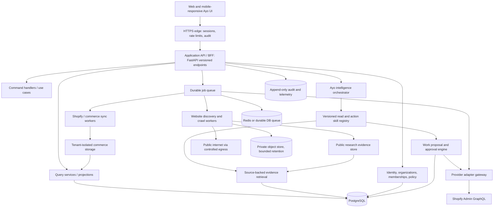

# 12 — Ayo end-to-end architecture and trust boundaries

**Classification: target engineering architecture, not delivered product.** Owner: founding engineering. Last updated 25 Oct 2026.

## Design axioms
- Ayo is one coherent intelligence. Internal capabilities are independently versioned services/tools, selected by an orchestrator. Users should not orchestrate agents themselves.
- Every entity, cache entry, job, tool call, trace and action belongs to a tenant or explicitly to a separate public-research context.
- Public website observation ≠ proof of domain ownership ≠ private commerce authorization ≠ permission to perform an action.
- All externally obtained text is untrusted; it is **never** a system instruction or tool policy.
- A factual claim must be supported by evidence or labeled unknown/inferred. LLM produces explanations; deterministic services produce metrics and execute writes.
- Code at the beginning is an alpha (FastAPI/Jinja/SQLAlchemy). Prefer an incremental modular-monolith approach; no premature microservices.

## Layered system

### L0 Experience and interaction
`/`, `/app`, `/app/ayo`, `/app/work`, `/app/grow`, `/app/business`, `/app/research`, `/app/connections`, `/app/settings` (target). Authentication and organization selection are real. UI shows provenance, scan/sync progress, empty and stale states. Link all reports to source URLs and timestamps. For actions provide a human-readable diff and confirmation.

### L1 Identity and tenancy
User identity/session/email verification/reset/MFA later, business creation and membership roles (`owner`, `admin`, `analyst`, `operator` where necessary), invite acceptance, ownership claims and settings. Server resolves `business_id` from authorized session membership, never trusts arbitrary client `business_id`. DB foreign keys and row level security as defense-in-depth with tests (or equivalent strict scoped repositories). Zero data sharing between tenants.

### L2 API / command boundary
FastAPI Pydantic or typed equivalent validates all requests. Split commands (mutating) from queries (read). Idempotency keys on commands, pagination and stable cursors, 202 Accepted for queued research/sync, explicit errors and 429 with retry hints, ETags for read endpoints. Rate limits per account/IP/tenant/domain. Version `/api/v1` once extending alpha.

### L3 Domain service layer
`Business`, `WebsiteResearch`, `Commerce`, `Metrics`, `Intelligence`, `Work`, `Approvals`, `BillingEntitlements`, `Privacy`. No raw SQL or provider SDK directly inside routes. Every use case has tested input/output and an explicit permission object.

### L4 Unified intelligence / orchestration
Route user intent to **approved tool registry**. Examples: `research.search_websites`, `research.read_site_report`, `commerce.get_order_trends`, `commerce.list_products`, `growth.find_catalog_gaps`, `work.prepare_product_edit`. Tool signature declares read/write, required evidence, scopes, rate budget, tenancy, timeout, supported providers and version. LLM can choose approved tools but cannot dynamically grant privileges, author external HTTP endpoints or invent data. Ayo's response includes sources/confidence, limits, proposed next action and whether real action is available.

### L5 Data ingestion and enrichment
Two distinct adapter families:
- `Public research`: search provider discovery → URL normalization → public egress safety → robots/sitemap → bounded HTML fetch or controlled rendering → extraction → source snapshots → fact graph → report.
- `Private commerce`: verified Shopify OAuth → token vault → GraphQL APIs → pagination + webhook-triggered incremental jobs → normalized provider entities → deterministic projections with reconciliation.
Never merge public and private data on domain string alone; require verified ownership and explicit linkage.

### L6 Durable execution
Workers with persistent job state, leases, retries/exponential backoff, dead-letter, cancellation, checkpoint, request budget, observability. Domain research & Shopify API calls must not run indefinitely in incoming web requests. Separate resource pools for internet crawling and Shopify sync. Report progress from persisted events, not invented %. Support worker kill/restart and duplicate event delivery.

### L7 Data and security infrastructure
PostgreSQL authoritative relational DB; Redis optional for queue/rate caches; object store for source-page snapshots if necessary with strict retention; secrets manager/KMS for OAuth tokens; per-environment separate encryption and signing keys, backups, migration tooling. Never store unrestricted raw personal data from crawled pages. Encrypt customer/provider sensitive fields at rest; use parameterized SQL. Verify backups through restore tests.

### L8 Governance, monitoring and QA
Structured logs with tenant-safe metadata and correlation IDs; traces across request/job/tool; no secrets, prompt text with PII, full HTML or merchant raw data in analytics by default. Security alerts for SSRF attempts, abnormal token use, webhook failure and cross-tenant access. Automated unit/integration/security/E2E tests; operation runbooks, SLOs, rollback, abuse reporting and privacy processes.

## Classification model
`PUBLIC_UNVERIFIED` website facts; `PUBLIC_VERIFIED` owner-verified page/domain; `PRIVATE_AUTHORIZED` provider data; `DERIVED_DETERMINISTIC` metrics; `AI_INFERENCE` hypothesis; `EXECUTION_RECEIPT` provider write result. Each claim stores evidence lineage and access classification. Website HTML cannot elevate data classification or permissions.

## Provider adapter rules
Define `ProviderAdapter` with `capabilities()`, `requiredScopes()`, `authorize()`, `refresh()`, `readPage(cursor)`, `write(action,idempotencyKey)`, `verifyReceipt()`, `revoke()`, `handleWebhook()`, and `deleteData()`. Provider fields are normalized at ingestion; store raw provider ID + version for traceability. Avoid speculative support for other e-commerce platforms.

## Infrastructure environments
`local` mocks isolated fixtures only in tests; `staging` private real auth, staging DB, development Shopify app; `production` after privacy/security acceptance and owner approval. Separate secrets, callback URLs, webhooks and DBs. Block production deployment on failing CI, incomplete migrations, missing current legal documents or untested protected-data scope.

## Deployment constraints / decisions
Keep FastAPI app as existing alpha while validating canonical Emergent source. Candidate production deployment: containerized API + worker with Postgres, managed Redis/queue, HTTPS edge and object store. Frontend can remain Jinja or become React via incremental migration and API contracts, not wholesale guesswork. Architect deployment-agnostically; Codex chooses after measuring complexity, costs and testability. Set architecture decisions in ADRs; avoid pretending Floot, Lovable, Base44 or Replit are the canonical codebase.
